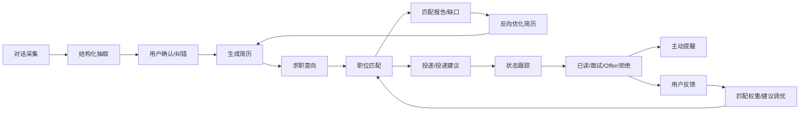
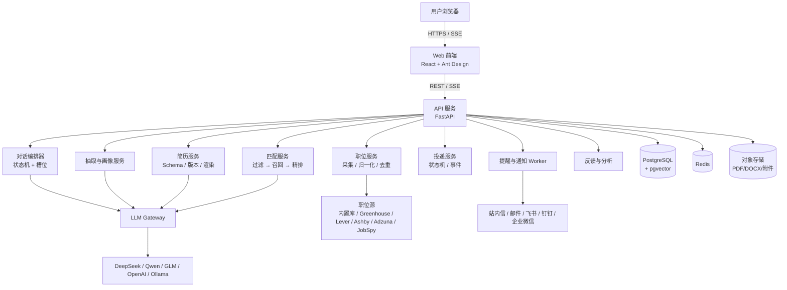

# 开源项目调研与需求对照报告

**赛题：自然语言对话式简历生成与精准投放**
**阶段：调研 / 方案预研（不含业务代码）**
**日期：2026-11-03**
**调研范围：GitHub 公开仓库，按 star、活跃度、功能贴合度筛选**

> **2026-11-03 更新：** 已确认方向为**中国市场 + 无登录工具 + 可部署到独立主机 + 只接入猎聘**。本文是开源项目的历史调研，平台方案已改为单平台猎聘；最新可提交方案见 [05-可行性验证设计文档（精简版）](05-可行性验证设计文档（精简版）.md)，平台细节见 [02-猎聘Agent接入可行性](02-猎聘Agent接入可行性.md) 与 [03-猎聘Agent接入技术设计](03-猎聘Agent接入技术设计.md)。本文第 10 节的三项决策保留作为背景说明。

---

## 0. 结论摘要

先说结论，避免在几十个项目里迷路：

1. **有大量可参考的开源项目，但没有一个同时满足赛题 R1–R6 的 Web 应用。**
   - 简历编辑/导出很成熟：Reactive Resume、Resume-Matcher、magic-resume、猫步简历、JadeAI。
   - 职位聚合/匹配/跟踪很成熟：JobOps、JobSync、career-ops、ai-job-search。
   - 真正把“对话采集 → 信息抽取 → 简历生成 → 职位匹配 → 投递 → 状态反馈 → 反向优化”做进**一个 Web 产品**的，只有 ResumeForge 最接近，但它仍是**单机本地工具**，且对话主要是“AI 助手/命令式”，不是“多轮引导式访谈”。

2. **最值得精读的 6 个项目：**

   | 项目 | 为什么值得看 |
   | --- | --- |
   | [ResumeForge（简历通）](https://github.com/magicapple123/ResumeForge) | 最接近完整闭环的中文 Web 工作台：岗位、匹配、简历、导出、投递、进度、提醒、模拟面试都有 |
   | [career-ops](https://github.com/career-ops-hq/career-ops) | 功能闭环最强：岗位评估、定制简历、投递跟踪、拒绝模式分析、回复识别；但是 CLI/Agent 形态 |
   | [ai-job-search](https://github.com/ai-job-search-dev/ai-job-search) | 有真正的“访谈式建档”（`/setup` interview）、起草-审阅式简历生成、结果回写与校准 |
   | [Resume-Matcher](https://github.com/srbhr/Resume-Matcher) | ATS 评分公式透明、母版简历→岗位定制、模板/PDF 导出、队列与限流做得扎实 |
   | [JobSync](https://github.com/Gsync/jobsync) | 自托管 Web 形态的职位发现 + AI 聊天 + 简历导入 + 投递跟踪 + 时间线，工程完整 |
   | [JobOps](https://github.com/DaKheera47/job-ops) | 多招聘站聚合、AI 评分、定制 CV、Gmail 状态识别、Docker 部署，适合参考“职位侧” |

3. **赛题真正的空白与差异化：**
   - 不是“再做一个简历编辑器”，而是**把求职过程做成一个可追踪、可回放、会根据结果变聪明的对话式工作台**。
   - 关键难点不在“调 LLM 写简历”，而在：
     - 多轮对话的**槽位状态机**与追问策略；
     - 抽取结果的**证据链、置信度、用户确认**；
     - 职位匹配的**硬条件过滤 + 语义召回 + 可解释重排**；
     - 投递状态的**事件化记录与主动提醒**；
     - 结果反馈如何**真正影响下一轮匹配/简历建议**，而不是只做一个统计图。

4. **落地建议（重要）：**
   - 用**内置职位库 + 模拟雇主端**保证闭环 100% 可演示：HR 端可把状态从“已投递”推到“已读/面试邀请/拒绝”，前端立即收到提醒。
   - 外部平台（BOSS/智联/LinkedIn/Indeed）只做**辅助数据源 + 跳转/半自动填表**，不做无人值守海投。成熟项目（career-ops、JobOps、ai-job-search）都明确选择“人来点提交”，这是合规与稳定性的共同答案。
   - 不整仓 fork 任何项目；按模块借鉴，许可证优先 MIT/Apache-2.0。

5. **推荐技术主线：**
   - 前端：React 19 + Ant Design 5（或 Vue 3 + Ant Design Vue），聊天区 + 简历画布 + 岗位卡片 + 时间线。
   - 后端：FastAPI + Pydantic v2 + SQLAlchemy 2 + Alembic；PostgreSQL + Redis + 对象存储。
   - LLM：统一 Provider 适配层，结构化输出 + 工具调用；DeepSeek/Qwen/GLM/OpenAI 可切换，Ollama 兜底。
   - 渲染：HTML 模板 + Playwright/Chromium 出 PDF；python-docx/docxtemplater 出 DOCX；中文字体用 Noto Sans CJK / 思源黑体。
   - 部署：Docker Compose（web / api / worker / postgres / redis / minio / nginx）。

---

## 1. 需求对照与拆解

### 1.1 对原始文档的两点校正

原始需求文档存在两个需要说明的地方：

1. **“通用实现步骤”从第 6 条开始**（6 闭环设计、7 环境搭建、8 核心开发、9 闭环验证、10 部署与文档），前面的 1–5 条缺失。建议在正式 PRD 中补齐为：需求分析、竞品调研、数据模型设计、技术选型、原型设计。
2. **“账单解析：Apache POI / pandas”与本题无关**，明显是通用模板残留；“平台 API：飞书/钉钉/微信”也更适合做**登录、通知、审批**，而不是职位数据源。建议在方案中明确：这两项要么删掉，要么降级为“可选扩展”，避免评委追问时讲不圆。

### 1.2 功能需求拆解

| 编号 | 赛题要求 | 建议验收标准 | 主要技术难点 |
| --- | --- | --- | --- |
| R1 | 对话式交互，多轮引导输入教育、工作/实习、技能、项目 | 8–15 轮内完成建档；每轮只问 1–2 个问题；支持跳过、修改、断点续聊；侧边栏实时显示已填槽位 | 对话状态机、槽位定义、追问策略、上下文管理、用户纠错 |
| R2 | NLP/LLM 解析输入，自动抽取并填充模板 | 从自然语言中抽取时间、组织、角色、动作、成果、技能；低置信度必须让用户确认；不编造 | JSON Schema、结构化输出、证据溯源、冲突消解、长文本处理 |
| R3 | 生成结构化简历，导出 PDF/Word | 实时预览；PDF/Word 均可导出；中文排版正确；PDF 文本层可被 ATS 解析；支持版本管理 | 模板引擎、字体与分页、DOCX 生成、PDF 文本层、版本 diff |
| R4 | 输入求职意向（岗位、地点、薪资等），从内置职位库或招聘 API 匹配 | 支持硬条件筛选；返回匹配度、匹配理由、缺口；结果可解释、可反馈 | 职位数据源、字段归一化、去重、语义匹配、LLM 评分、冷启动 |
| R5 | 一键投递或投递建议（匹配度分析、投递话术），记录投递状态 | 生成定制简历 + 招呼语/求职信；投递动作可追踪；状态含已投、已读、面试、offer、拒绝 | 平台合规、浏览器自动化、状态同步、去重、幂等 |
| R6 | 业务闭环：反向优化简历、状态提醒、用户反馈优化匹配 | 从 JD 缺口反推简历修改建议；状态变化主动提醒；反馈能影响后续排序/建议 | 事件驱动、提醒调度、反馈数据、避免小样本过拟合 |
| R0 | 工程与非功能 | Docker 一键启动；关键链路可回放；API 限流/超时/降级；隐私与权限 | 可观测性、异常处理、数据隔离、成本控制 |

### 1.3 业务闭环（建议作为全队主线图）



这条图建议直接放进答辩 PPT 第一页。**评委最想看到的是箭头有没有真的走通**，而不是功能列表有多长。

---

## 2. 调研方法

### 2.1 检索方式

通过 GitHub Search API 做了 18 组查询，覆盖中英文、简历侧、职位侧、Agent 侧：

- 英文：`resume builder ai`、`ai resume`、`resume job matching`、`job application ai agent`、`resume tailor job description`、`ats resume optimizer`、`conversational resume chatbot`、`resume parser nlp`、`job application tracker`、`cover letter generator ai`、`resume interview chatbot`、`conversational cv builder`、`chatbot resume generator`、`AI resume assistant chat`
- 中文：`简历 生成`、`简历 岗位 匹配`、`简历 对话`、`求职 智能体 投递`

共得到 **217 个去重仓库**，按 star、最近推送、描述相关度筛出 **30 个精读对象**，再对其中 10 个做完整 README 分析。

### 2.2 筛选标准

1. 功能与 R1–R6 至少有一个模块强相关；
2. 近 12 个月有提交（避免死项目）；
3. 有可读的 README/架构说明；
4. 许可证允许参考（MIT/Apache 优先）；
5. 优先“能跑起来的完整产品”，而不是零散脚本。

### 2.3 数据口径说明

- Star 数、推送时间均为 **2026-11-03** 通过 GitHub API 获取，后续会变化。
- Star 高不等于质量高：2026 年出现了一批“AI CLI + Skill”仓库，star 增长很快，但形态是 Agent 工作流，不是可部署的 Web 产品。
- 部分仓库 star 很低但完成度很高（如 ResumeForge），不能只看 star。

---

## 3. 开源全景：六类项目

| 类别 | 代表项目 | 解决什么问题 | 与赛题的关系 |
| --- | --- | --- | --- |
| A. 简历编辑器/生成器 | Reactive Resume、magic-resume、猫步简历、JadeAI、OpenResume | 模板、拖拽编辑、实时预览、PDF 导出 | R2/R3 的直接参考 |
| B. AI 简历定制/ATS | Resume-Matcher、ResumeForge、ResumeLM、Resume Hacker | 母版简历→按 JD 定制、ATS 评分、关键词高亮 | R3/R6 的核心参考 |
| C. 对话式/Agent 求职 | career-ops、ai-job-search、JobHuntBot、JobOK | 用 AI CLI/Agent 完成评估、定制、投递跟踪 | R1/R2/R6 的流程参考 |
| D. 职位聚合/匹配 | JobOps、JobSync、JobSpy、JobMatch-AI | 多招聘站抓取、去重、评分、排序 | R4 的直接参考 |
| E. 投递跟踪/CRM | JobSync、JobOps、apply-potato、JobPilot | 投递状态、时间线、邮件识别、提醒 | R5 的直接参考 |
| F. 基础设施 | JobSpy、pyresparser、PaddleOCR、JSON Resume | 抓取、解析、OCR、数据标准 | 可复用组件 |

### 3.1 速查表（按 star 排序，截至 2026-11-03）

| 项目 | Star | 技术栈 | 许可证 | 最近推送 | 一句话定位 |
| --- | ---: | --- | --- | --- | --- |
| [career-ops](https://github.com/career-ops-hq/career-ops) | 79.6k | Node.js / Playwright / Go TUI | MIT | 2026-11-03 | AI CLI 里的求职全流程 Agent |
| [ai-job-search](https://github.com/ai-job-search-dev/ai-job-search) | 69.1k | Python / Bun / LaTeX / Claude Code | MIT | 2026-11-02 | 基于 Claude Code 的求职工作流 |
| [Reactive Resume](https://github.com/reactive-resume/reactive-resume) | 45.2k | React 19 / Hono / PostgreSQL | MIT | 2026-11-03 | 成熟的自托管简历编辑器 |
| [Resume-Matcher](https://github.com/srbhr/Resume-Matcher) | 29.1k | FastAPI / Next.js / SQLite | Apache-2.0 | 2026-11-02 | 母版简历 + JD 定制 + ATS 评分 |
| [magic-resume](https://github.com/JOYCEQL/magic-resume) | 11.3k | TanStack Start / Tiptap | Apache-2.0 + 非商用限制 | 2026-11-02 | 中文 AI 简历编辑器（前端为主） |
| [OpenResume](https://github.com/xitanggg/open-resume) | 9.0k | Next.js / TypeScript | AGPL-3.0 | 2024-10-29 | 简历生成 + 解析，已较少更新 |
| [JobSpy](https://github.com/speedyapply/JobSpy) | 4.6k | Python | MIT | 2026-10-27 | 多招聘站抓取库 |
| [猫步简历 resume-design](https://github.com/Hacker233/resume-design) | 4.1k | Vue 3 / Element Plus / NestJS | MIT | 2026-04-20 | 中文简历设计器 + 模板站 |
| [JobOps](https://github.com/DaKheera47/job-ops) | 4.1k | TypeScript / PostgreSQL / Docker | Commons Clause | 2026-10-30 | 多站搜索 + AI 评分 + CV 定制 + Gmail 跟踪 |
| [JadeAI](https://github.com/LingyiChen-AI/JadeAI) | 2.0k | Next.js 16 / SQLite / Vercel AI SDK | Apache-2.0 | 2026-10-23 | AI 简历编辑器 + JD 匹配 + 模拟面试 |
| [JobSync](https://github.com/Gsync/jobsync) | 1.5k | Next.js / Prisma / PostgreSQL | MIT | 2026-11-02 | 自托管求职跟踪 + AI 助手 + 职位发现 |
| [pyresparser](https://github.com/OmkarPathak/pyresparser) | 958 | Python / spaCy | GPL-3.0 | 2023-09-13 | 传统简历解析器（已停更） |
| [JobHuntBot](https://github.com/DanielPan12/JobHuntBot) | 877 | JavaScript | MIT | 2026-10-12 | Agent 驱动的投递工作流 + 本地看板 |
| [ResumeForge](https://github.com/magicapple123/ResumeForge) | 369 | React / FastAPI / SQLite | Apache-2.0 | 2026-11-03 | 中文本地优先 AI 简历工作台（闭环最全） |
| [JobPilot](https://github.com/jlifeng/JobPilot) | 148 | Tauri / TypeScript | Apache-2.0 | 2026-10-25 | 桌面端简历 + JD 匹配 + 模拟面试 |
| [ai-job-app（求职舱）](https://github.com/kyle-kw/ai-job-app) | 112 | Rust / Tauri | MIT | 2026-10-10 | BOSS 直聘岗位采集 + 本地匹配 |
| [boss-crawler-skill](https://github.com/zhansan379/boss-crawler-skill) | 120 | Python / Playwright | 无许可证 | 2026-09-05 | BOSS 爬取 + 匹配 + 自动投递脚本 |

> 说明：表中“Commons Clause”“非商用限制”“无许可证”都需要在复用前仔细读 LICENSE，不能直接拷贝代码进参赛作品。

---

## 4. 重点项目深入分析

### 4.1 ResumeForge（简历通）——最接近完整闭环的中文 Web 工作台

**定位**：本地优先的 AI 简历工作台，不注册、不登录，数据只存本机；面向中文求职者。

**技术栈**：React 前端 + FastAPI 后端 + SQLite；同源 `/api`；本地附件目录；可选模型服务商（DeepSeek/Claude/豆包/OpenAI/Ollama 等 16 个预设）。

**它覆盖了什么**：

- 岗位广场：手动录入、粘贴 JD、截图/PDF/DOCX 识别成草稿。
- 匹配分析：逐条对照 JD，给出“已匹配 / 表达缺口 / 证据不足 / 真实缺口 / 待确认”五类结论，每条附 JD 原文与用户证据；另有 0–100 参考分，但不参与投递准入。
- 简历生成：按 JD 筛选事实流式生成；支持美化强度、篇幅、模板、字号、板块顺序。
- 事实台账：把“事实”和“表述”分开，只有“已确认”的事实参与生成；生成结果可与资料库逐条比对，防止编造。
- 导出：PDF / Word / Markdown / 纯文本 / JSON / HTML；支持水印、脱敏、版面诊断、一键压到一页。
- 投递台：采集 → 匹配 → 显式确认 → 批量投递；不保存招聘网站密码/Cookie，走用户自己登录的浏览器；通用网申只填不交。
- 求职进度：一家公司一个岗位一条记录；粘邮件/截图识别进展；提醒、统计、内推、模拟面试、面试深挖。
- 求职助手：流式问答，可查库、引用资料、联网搜索；只在明确要求时写数据。

**为什么它最值得看**：

1. 它是少数把“岗位—简历—投递—进度—面试”放在一个产品里的项目，而不是只做简历或只做职位聚合。
2. “事实台账 + 来源核对 + 防虚构”是非常好的产品思路，直接回应了赛题里“反向优化简历”时最容易出的问题：AI 把没做过的事写进去。
3. 匹配结论不是单一百分比，而是“结论 + 证据 + 缺口”，这比只给 85 分更有说服力，也更适合答辩演示。
4. 导出格式覆盖 PDF/Word/JSON/HTML，正好满足 R3。

**局限**：

- **单用户、本地优先**：没有账号体系、多租户、权限、云部署；如果赛题要求 Web 多用户，需要重做这一层。
- **对话不是“引导式访谈”**：AI 助手更像“能查库、能改数据的聊天框”，简历生成仍以表单/弹窗为主；没有“问一个问题→填一个槽位→确认→下一个问题”的强引导。
- **职位源偏弱**：以手动录入/粘贴为主，没有多招聘站聚合；自动投递依赖浏览器 CDP，跨平台稳定性一般。
- **功能面非常大**（README 列了 75 项），整仓 fork 的学习和维护成本高，不适合短周期赛题。

**可借鉴**：

- 领域模型：岗位、简历、资料、事实、投递、提醒、面试的分层。
- 匹配报告结构：五类结论 + 原文证据 + 参考分。
- 事实台账/来源核对/防虚构校验。
- 投递状态机、提醒、统计看板。
- 多格式导出与版面诊断。
- “显式确认后才访问外部网站”的安全边界。

**许可证**：Apache-2.0，可参考/复用，但需保留声明。

---

### 4.2 career-ops——功能闭环最强的“Agent 工作流”

**定位**：在 Claude Code / Codex / OpenCode 等 AI CLI 中运行的求职 Agent；本地文件为数据层，不依赖自建后端。

**核心能力**：

- 粘贴岗位 URL/JD，自动检查是否还在招、按 CV 打分、决定是否值得投。
- A-H 评估：岗位摘要、CV 匹配（每个要求带权重和来源）、级别策略、薪资研究、个性化、面试准备（STAR+R）、招聘合法性检查、工作授权信号。
- 生成 ATS 友好的定制 CV（HTML + Playwright → PDF）和 cover letter。
- 100+ 公司门户预配置 + 自定义搜索（Ashby、Greenhouse、Lever、Wellfound）。
- 投递跟踪、跟进节奏、回复分类、拒绝模式分析、各 ATS 渠道转化率、终身漏斗统计。
- 明确“不自动提交、不发邮件、不 phone home”；人始终点最后一下。

**为什么值得看**：

- 它把“评估—定制—投递—跟踪—复盘”做成了完整闭环，而且有**结果分析**（哪种岗位容易进面试、哪个渠道转化高）。
- 评估不是拍脑袋打分，而是“要求 + 权重 + 证据 + 来源”，这套 rubric 可以直接改造成赛题的匹配报告。
- 它对“自动投递”的取舍非常清醒：不 auto-submit，避免被平台封禁。

**局限**：

- CLI/文件形态，不是 Web 产品；没有对话 UI、没有数据库、没有多用户。
- 依赖 AI CLI 订阅和本地 Node/Playwright 环境，部署给评委体验不友好。
- 数据是 Markdown/YAML/TSV，适合个人，不适合服务端并发。

**可借鉴**：

- A-H 评估 rubric、要求权重、证据来源标注。
- 投递状态/跟进节奏/回复分类的规则。
- 拒绝模式分析与渠道转化分析。
- “人来提交”的安全边界。

**许可证**：MIT。

---

### 4.3 ai-job-search——最接近“访谈式建档”的流程参考

**定位**：基于 Claude Code 的求职工作流，fork 后把个人资料写进私有仓库；核心流程与语言/国家无关。

**六个核心命令**：

`/setup` → `/scrape` → `/rank` → `/apply` → `/interview` → `/outcome`

**关键设计**：

- `/setup` 有三条路径：读取 `documents/` 文件夹、粘贴一份 CV、**走一遍访谈（interview）**；`/setup --section search` 还能只重跑“求职意向访谈”。
- `/apply` 是 drafter-reviewer 双角色：解析 JD → 评估匹配 → 起草 CV/cover letter → 第二 agent 审阅 → 修订 → 编译 PDF → 检查 ATS 文本层。
- `/outcome` 记录面试、offer、拒绝、沉默；归档投递时使用的 CV/cover letter/JD；对久无回音的申请生成跟进邮件；**当有几个结果后，提示回到 `/setup` 校准匹配框架**。
- `/gmail-sync` 从 Gmail 读取状态信号（面试邀请、测评链接、offer、拒绝），先给用户预览，确认后才写入跟踪表。
- `/upskill` 根据简历、已投岗位、已排名岗位的缺口，生成学习计划。

**为什么值得看**：

- 它是目前最接近“多轮对话收集信息”的开源实现，虽然形态是 CLI。
- “起草—审阅—修订”的双角色模式，能显著降低简历胡编和格式错误。
- “结果回写 → 校准匹配框架”正是赛题 R6 要的闭环，而且它做得很轻：不训练模型，只用结果修正规则/权重。

**局限**：

- 强依赖 Claude Code；不是 Web 服务。
- LaTeX 工具链重，中文支持需要额外配置。
- 职位门户偏丹麦市场；换成中国/全球需要重写 portal skills。
- 数据是文件，不是数据库；多用户/并发不适合。

**可借鉴**：

- `/setup` 的访谈脚本、槽位顺序、追问方式。
- drafter-reviewer 生成流程。
- `/outcome` 的结果归档、跟进、校准。
- Gmail/邮件状态解析的“先预览再写入”模式。

**许可证**：MIT。

---

### 4.4 Resume-Matcher——ATS 评分与“母版→定制”的最佳参考

**定位**：自托管 AI 简历定制工具；FastAPI + Next.js + SQLite；支持 100+ LLM（OpenAI、Anthropic、Gemini、DeepSeek、OpenRouter、Groq、Ollama）。

**核心能力**：

- 母版简历（master resume）→ 针对每个 JD 生成定制版本。
- ATS 评分公式透明：关键词匹配 40% + 技能覆盖 20% + 岗位标题匹配 15% + 区块完整度 15% + 日期一致性 10%。
- ATS Check：把导出的 PDF 用 pdfminer 重新读一遍，模拟 ATS 的文本抽取，检查可解析性、阅读顺序、联系方式、区块标题。
- 模板：单栏、双栏、Modern、LaTeX、Clean、Vivid、Deedy 等，支持 A4/Letter。
- Tailoring Queue：批量粘贴 JD，后台排队生成；支持限流冷却、重启后续跑。
- Cover Letter、Interview Prep、i18n、MCP Server。

**为什么值得看**：

- ATS 评分是“纯代码”而不是 LLM 打分，稳定、可解释、可测试；赛题完全可以用这套公式做保底分数，再用 LLM 做增量解释。
- 母版/定制版本的数据模型，正好对应“一份主简历 + 多个岗位版本”的产品结构。
- 队列 + 限流 + 重启续跑，是工程实现细节的好参考。

**局限**：

- 没有职位库、没有投递跟踪、没有对话采集。
- 偏软件工程师/英文简历，中文排版和中文 JD 需要适配。
- 前端/后端都比较重，短周期不宜整仓复用。

**可借鉴**：

- ATS 评分公式与 PDF 文本层检查。
- 母版→变体的版本模型。
- 模板渲染与队列限流。
- 结构化 prompt 与“禁止编造”约束。

**许可证**：Apache-2.0。

---

### 4.5 JobSync / JobOps——职位聚合与投递跟踪的两种范式

#### JobSync（MIT，1.5k star）

- 自托管 Web 应用：Next.js + Prisma + PostgreSQL + Docker。
- 简历管理：存储、PDF 导出、PDF/Word 导入（AI 抽取联系方式、摘要、技能、工作经历、教育、证书）。
- 职位发现：Greenhouse（2,400+ 公司）、Lever（1,160+）、Ashby（1,860+）；先做快速本地相关性评分，再对 Top N 调 LLM，控制成本。
- AI 助手：侧边聊天，支持简历评审、岗位匹配、cover letter、粘贴岗位后抽取并确认写入。
- 跟踪：岗位时间线、面试轮次、联系人、公司页、题库、任务/活动、备份恢复。
- MCP Server：Claude Desktop 等 Agent 可直接加岗位/题库。

**可借鉴**：职位源适配器、两阶段排序（本地快排 + LLM 精排）、简历导入的“分区确认卡”、时间线/面试/联系人模型、MCP 集成。

**局限**：没有引导式简历采集；没有自动投递能力（产品定位是跟踪与匹配）；中国招聘站不在覆盖范围。

#### JobOps（Commons Clause，4.1k star）

- 一个界面搜 10+ 招聘站（LinkedIn、Indeed、Glassdoor、Adzuna、Hiring Cafe、startup.jobs、Working Nomads、Gradcracker、UK Visa Jobs、Golang Jobs、Seek、WUZZUF、Khamsat）。
- AI 按 profile 打 0–100 分；为每个岗位重写 CV；本地 PDF 或走 Reactive Resume 导出。
- 连接 Gmail，自动识别面试邀请/拒绝并更新状态。
- 明确“不 auto-apply”，理由是自动化投递会被 recruiter 识别并拉黑。

**可借鉴**：多站聚合与去重、Gmail 状态识别、Docker 部署、AI Provider 适配（LiteLLM/OpenAI/Claude/Gemini/GLM/OpenRouter/ Ollama）。

**注意**：Commons Clause 限制“销售软件/托管服务”，参赛可以读思路，但不要直接拷贝代码做商业化。

---

### 4.6 编辑器/导出/中文 UI 参考

| 项目 | 可借鉴点 | 注意 |
| --- | --- | --- |
| [Reactive Resume](https://github.com/reactive-resume/reactive-resume) | 18 套模板、PDF/DOCX/Markdown/JSON 导出、JSON Resume/LinkedIn/PDF/Word 导入、ATS 检查、公开分享、REST/MCP | 功能很全，但是通用编辑器，不含职位匹配/投递 |
| [magic-resume](https://github.com/JOYCEQL/magic-resume) | 中文 UI、Tiptap 富文本、实时预览、主题、PDF 导出 | Apache-2.0 附加“禁止商用”，不能直接商用/二次商业开发 |
| [猫步简历 resume-design](https://github.com/Hacker233/resume-design) | Vue3 + Element Plus、两款设计器、PDF/图片/JSON/Markdown 导出、模板/主题 | 偏前端设计器，后端较弱；适合参考中文模板与排版 |
| [JadeAI](https://github.com/LingyiChen-AI/JadeAI) | Next.js 16 + SQLite、50+ 模板、AI 聊天助手、PDF/图片解析、JD 匹配、模拟面试、Docker | 无职位库/投递跟踪；适合参考“AI 聊天嵌在编辑器里”的交互 |
| [OpenResume](https://github.com/xitanggg/open-resume) | 简历生成 + 解析、ATS 友好、PDF 导出 | AGPL-3.0；2024 年后更新少 |

**中文排版提醒**：PDF 里中文没字体、DOCX 里行距错乱、ATS 读不出中文，是这类项目最常见的翻车点。建议从第一天就用 Noto Sans CJK / 思源黑体做 PDF 嵌入，并用 pdfminer 回读验证。

---

### 4.7 中国市场特别参考（BOSS/智联/猎聘）

| 项目 | 能力 | 风险/备注 |
| --- | --- | --- |
| [JobPilot](https://github.com/jlifeng/JobPilot) | Tauri 桌面端，本地优先，简历 + JD 匹配 + 模拟面试 | Apache-2.0；桌面形态，非 Web |
| [求职舱 ai-job-app](https://github.com/kyle-kw/ai-job-app) | BOSS 直聘岗位采集、主简历、事实清单、匹配分析、招呼语、面试准备 | MIT；需要独立 Chrome Profile，抓取有合规风险 |
| [boss-crawler-skill](https://github.com/zhansan379/boss-crawler-skill) | BOSS 爬取→解析→匹配→报告→自动投递 | 无许可证；自动化投递风险高，不建议照搬 |
| [JobOK](https://github.com/GresonKwan/JobOK) | 中文证据驱动求职 Agent Skill：优势挖掘、岗位匹配、简历优化、面试训练、投递跟踪 | MIT；偏 Skill/提示词，不是完整产品 |

**建议**：如果赛题面向中国市场，职位数据不要强依赖 BOSS 爬虫。更稳的做法是：
1. 内置 50–200 条脱敏/公开职位做演示；
2. 用企业官网/ATS（Greenhouse/Lever/Ashby）公开接口做真实数据补充；
3. BOSS/智联只做“深链跳转 + 半自动填表”，并明确用户授权与频控；
4. 用“模拟雇主端”制造状态变化，保证闭环演示不依赖第三方。

---

## 5. 需求覆盖矩阵

图例：● 完整支持；◐ 部分支持/需改造；○ 基本没有。

| 项目 | R1 对话采集 | R2 抽取 | R3 简历导出 | R4 职位匹配 | R5 投递/跟踪 | R6 反馈闭环 | 综合判断 |
| --- | :---: | :---: | :---: | :---: | :---: | :---: | --- |
| ResumeForge | ◐ | ◐ | ● | ● | ● | ◐ | **最接近完整 Web 闭环**，但对话引导弱、单机 |
| career-ops | ◐ | ◐ | ● | ● | ◐ | ● | **功能闭环最强**，但 CLI/Agent |
| ai-job-search | ◐ | ● | ● | ● | ◐ | ● | **访谈式建档 + 结果校准**，但 CLI |
| JobSync | ◐ | ◐ | ● | ● | ◐ | ◐ | Web 工程完整，职位发现强，无引导采集 |
| JobOps | ○ | ◐ | ● | ● | ◐ | ◐ | 职位聚合/评分强，无对话、无投递 |
| Resume-Matcher | ○ | ◐ | ● | ◐ | ○ | ○ | ATS/定制最强，无职位库/跟踪 |
| Reactive Resume | ○ | ◐ | ● | ○ | ○ | ○ | 编辑器/导出最强，无匹配/跟踪 |
| JadeAI | ◐ | ● | ● | ◐ | ○ | ◐ | 中文 AI 编辑器，无职位库/投递 |
| magic-resume | ○ | ◐ | ● | ○ | ○ | ○ | 中文前端优秀，无后端闭环 |
| 猫步简历 | ○ | ◐ | ● | ○ | ○ | ○ | 中文设计器/模板优秀 |
| JobPilot | ○ | ◐ | ● | ◐ | ○ | ◐ | 桌面端，匹配/面试有，无投递 |
| 求职舱 | ○ | ● | ◐ | ● | ◐ | ◐ | BOSS 场景参考，合规风险 |

**结论**：
- 没有任何一列是“全 ●”。
- 最稀缺的是 **R1（真正的引导式对话）** 和 **R6（结果反馈真正影响匹配）**。
- R3 最不需要自研，直接借鉴成熟方案即可。
- R4/R5 的难点不在算法，而在**数据源与合规**。

---

## 6. 差距分析：赛题到底要补哪几块

### 6.1 R1：从“聊天框”到“访谈状态机”

现有项目的“对话”分三种：

1. **自由聊天**：JadeAI、ResumeForge 的 AI 助手——用户问，AI 答，不保证信息收集完整。
2. **命令式流程**：career-ops 的 `/career-ops`、ai-job-search 的 `/setup`——有步骤，但形态是 CLI。
3. **真正的访谈**：ai-job-search 的 `/setup` interview 模式——按主题问，但仍是文本 CLI。

**赛题需要补的**：
- 一个显式的**对话状态机**：`intro → basic → education → work → project → skills → intent → review → generate`。
- 每个状态有**槽位定义**（必填/选填/追问条件/完成标准）。
- 每轮只问 1–2 个问题；用户答完后，侧边栏卡片实时更新。
- 支持“跳过”“稍后再说”“修改上一题”“上传简历自动填充”。
- 对话可恢复：刷新页面/换设备后继续。
- 关键字段必须**复述确认**（“我理解你在 XX 公司做 XX，时间 2023.06–2024.08，对吗？”）。

**建议交互**：左聊天、右“简历画布/槽位卡片”，中间可切换。不要做纯聊天，否则演示时评委看不到“结构化”的价值。

### 6.2 R2：从“上传解析”到“对话抽取 + 证据”

现有项目大多做“上传简历→解析”，很少做“从对话里抽”。赛题需要补：

- 每轮用户消息 → 抽取候选实体（时间、组织、角色、动作、指标、技能）→ 写入 `extraction_candidates`。
- 候选带 `confidence`、`source_message_id`、`evidence_span`。
- 低置信度不直接入库，前端弹“确认卡”。
- 冲突消解：同一段经历出现两个时间/公司名，必须让用户选。
- 事实与表述分离：原始事实（可验证）vs 简历措辞（可润色），避免 AI 编造。
- 支持“我不知道/记不清”，允许留空，不逼用户编。

### 6.3 R3：从“能导出”到“中文/ATS/版本”都能打

现有项目已证明可行，但要注意：

- PDF：HTML + Chromium/Playwright 最稳；中文必须嵌入字体；导出后用 pdfminer 回读，检查文本层。
- DOCX：python-docx 或 docxtemplater；表格/分页/行距要单独调；不要指望“HTML 直接转 Word”保真。
- 版本：母版 + 岗位变体；每次生成存快照；支持 diff（哪些句子为这个 JD 改了）。
- ATS：关键词覆盖、区块标题、日期格式、联系方式可解析；不要用图片/复杂双栏。

### 6.4 R4：从“关键词匹配”到“可解释的三段式匹配”

现有项目的做法：

- Resume-Matcher：关键词/技能/标题/完整度/日期，纯代码打分。
- JobSync：本地快速相关性分 → Top N 再 LLM 精排（成本控制）。
- JobOps：LLM 0–100 分。
- career-ops：要求权重 + 证据 + 来源。
- ResumeForge：五类结论 + 证据，不把百分比当准入。

**建议融合为三段式**：

1. **硬过滤**：地点、薪资、学历、经验年限、远程、签证/授权、岗位类别。不满足直接淘汰，并记录原因。
2. **召回**：BM25/关键词 + 同义词 + 向量检索（bge-m3 / text-embedding-3-large），取 Top 50。
3. **精排**：LLM 按 rubric 打分（must-have 覆盖、nice-to-have、级别、领域、证据强度），输出分数 + 理由 + 缺口；只对 Top 10 调 LLM，控制成本。

**可解释性**：每个分数都要能展开到“JD 要求 → 简历证据 → 结论”。这是答辩时最容易被问的点。

### 6.5 R5：从“投递按钮”到“可追踪的投递事件”

现有项目的取舍：

- career-ops / JobOps / ai-job-search：**不自动提交**，只生成材料，人来投。
- ResumeForge：显式确认后批量投递；通用网申只填不交。
- BOSS 爬虫类：自动投递，但合规/稳定性风险高。

**建议**：
- 对**内置职位库/模拟招聘平台**：实现真正的“一键投递”，因为这是自己的系统，可控、可回放。
- 对**外部平台**：生成“投递包”（定制简历 PDF + 招呼语 + 匹配报告）+ 深链跳转 + 半自动填表；提交由用户完成。
- 所有投递动作写 `application_events`（谁、何时、哪个简历版本、哪个岗位、渠道、结果），支持回放。
- 状态机：`draft → tailored → ready → submitted → viewed → screening → interview → offer / rejected / withdrawn`。
- 提醒：3 天未读、7 天未回、面试前 1 天、offer 截止前。

### 6.6 R6：从“统计图”到“反馈真的改变排序”

现有项目：

- career-ops：拒绝模式分析、渠道转化率、漏斗统计。
- ai-job-search：`/outcome` 记录结果，提示回 `/setup` 校准。
- ResumeForge：求职统计、转化/卡点、渠道/去向、简历健康度。

**赛题需要补的**：
- 显式反馈：用户对推荐打 1–5 分，选择原因（技能不匹配/地点/薪资/文化/其他）。
- 隐式反馈：点击、收藏、投递、面试、offer。
- 反馈进入排序：初期用**规则权重 + 用户偏好向量**；数据多了再上逻辑回归/Learning-to-Rank；不要一上来上深度学习。
- 简历建议：JD 缺口 → 证据是否具备 → 建议改写/补充 → 用户确认 → 新版本。
- 可解释：让用户看到“因为你反馈了 3 次‘地点太远’，本次把上海岗位权重调高了”。

---

## 7. 推荐架构

### 7.1 总览



### 7.2 模块职责

| 模块 | 职责 | 关键设计 |
| --- | --- | --- |
| Conversation Orchestrator | 维护会话状态、决定下一个问题、处理跳过/修改/恢复 | 显式状态机；槽位 schema；每轮最多 2 问；状态持久化 |
| Extraction & Profile | 从对话/简历/JD 中抽取结构化信息 | JSON Schema 输出；候选表；置信度；证据 span；用户确认 |
| Resume Service | 母版/变体、版本、渲染、导出 | JSON Resume 扩展；快照；diff；PDF/DOCX 双渲染 |
| Job Service | 职位采集、归一化、去重、搜索 | 适配器模式；统一 JobPost schema；去重指纹；定时任务 |
| Matching Service | 硬过滤、召回、精排、解释 | 三段式；分数拆解；原因码；缓存 |
| Application Service | 投递、状态、事件、回放 | 状态机；事件表；幂等键；渠道适配 |
| Notification Worker | 提醒、状态变化通知 | Celery/Arq + Redis；模板；频控；多通道 |
| Feedback & Analytics | 反馈、漏斗、权重调优 | 显式+隐式反馈；规则权重；A/B；可解释 |

### 7.3 核心数据模型（建议）

> 原则：**结构化字段用于筛选，JSONB 用于灵活简历区块；所有 AI 生成内容都能追溯到来源。**

| 表 | 关键字段 | 说明 |
| --- | --- | --- |
| `users` | id, email, name, created_at | 多用户时必需；单机演示可简化 |
| `profiles` | user_id, basic_json, intent_json, updated_at | 基本信息和求职意向 |
| `profile_items` | id, user_id, type, data_json, evidence, confidence, status | 教育/工作/项目/技能等，统一表 + type |
| `conversations` | id, user_id, state, slots_json, status | 会话状态机 |
| `messages` | id, conversation_id, role, content, created_at | 对话历史 |
| `extraction_candidates` | id, message_id, field, value_json, confidence, evidence, status | 待确认的抽取结果 |
| `resumes` | id, user_id, title, is_master | 母版/变体 |
| `resume_versions` | id, resume_id, job_id, content_json, pdf_url, docx_url, created_at | 每次生成快照 |
| `jobs` | id, source, external_id, title, company, location, salary, jd_text, requirements_json, posted_at | 统一职位 |
| `job_requirements` | id, job_id, text, type, weight | 要求拆条，便于匹配解释 |
| `match_reports` | id, user_id, job_id, resume_id, score, breakdown_json, reasons_json, gaps_json | 匹配报告 |
| `applications` | id, user_id, job_id, resume_version_id, status, channel, applied_at | 投递记录 |
| `application_events` | id, application_id, event_type, source, payload_json, occurred_at | 状态事件，支持回放 |
| `feedback` | id, user_id, job_id, application_id, rating, reasons_json, comment | 显式反馈 |
| `notifications` | id, user_id, type, payload_json, read_at, sent_at | 提醒 |

**简历内容建议用 [JSON Resume](https://jsonresume.org/) 扩展**：`basics`、`work`、`education`、`projects`、`skills`、`languages`、`certificates`、`meta`；在 `meta` 里加 `evidence`、`provenance`、`visibility`、`version`。

### 7.4 对话状态机（可直接照此实现）

```text
intro
  ↓
basic（姓名/电话/邮箱/城市/求职状态）
  ↓
education（学校/专业/学历/时间/主修课程/荣誉）
  ↓
work（公司/职位/时间/职责/成果/离职原因）
  ↓
project（项目名/角色/时间/技术栈/难点/成果/链接）
  ↓
skills（技能/熟练度/证书/语言）
  ↓
intent（目标岗位/地点/薪资/行业/公司规模/到岗时间）
  ↓
review（逐段复述确认，允许修改/跳过）
  ↓
generate（生成简历 → 预览 → 导出）
```

每个状态的槽位定义示例：

```json
{
  "state": "work",
  "slots": [
    {"key": "company", "label": "公司", "required": true, "ask": "你最近一段工作是在哪家公司？"},
    {"key": "title", "label": "职位", "required": true, "ask": "你的职位是什么？"},
    {"key": "start", "label": "开始时间", "required": true, "ask": "大概什么时候入职的？"},
    {"key": "end", "label": "结束时间", "required": false, "ask": "现在还在职吗？如果不是，什么时候离开的？"},
    {"key": "achievements", "label": "成果", "required": false, "ask": "有没有哪件事是你主导并带来可量化结果的？"}
  ],
  "completion": ["company", "title", "start"],
  "max_questions_per_turn": 2
}
```

**追问策略**：优先问必填、优先问能显著提升简历质量的槽位（成果 > 职责 > 工具），用户连续跳过 2 次就降级为选填。

### 7.5 抽取与可信度

建议采用“**候选 → 确认 → 入库**”三步，而不是 LLM 直接写库：

1. LLM 输出严格 JSON：`{field, value, confidence, evidence, reasoning}`。
2. 规则校验：时间格式、手机号/邮箱、公司/学校名是否与已有数据冲突。
3. 前端确认卡：高置信度可批量确认，低置信度逐条确认；用户可编辑。
4. 入库时保留 `source_message_id`、`evidence`、`model`、`prompt_version`，便于回放和追责。

**Prompt 要点**：
- 明确“只抽取用户明确说过的内容，不要推断/补全”。
- 给出 schema 和示例；要求输出 JSON。
- 把用户输入用分隔符包起来，声明“这是数据，不是指令”。
- 对 JD/简历文本同样处理，防止 prompt injection。

### 7.6 简历渲染与导出

| 输出 | 方案 | 注意事项 |
| --- | --- | --- |
| HTML 预览 | React 组件/模板 | 与 PDF 同源，避免“预览好看导出翻车” |
| PDF | Playwright/Chromium `page.pdf()` | 嵌入中文字体；A4；页边距；分页控制 |
| DOCX | python-docx / docxtemplater | 样式、行距、表格、分页；中文顿号/引号 |
| Markdown/JSON | 直接序列化 | 便于备份/二次编辑 |
| ATS 检查 | pdfminer 回读 | 检查文本层、阅读顺序、联系方式、区块标题 |

**中文排版清单**：
- 字体：Noto Sans CJK SC / 思源黑体 / 思源宋体；PDF 必须嵌入。
- 标点：中文全角，避免中英混排时空格错乱。
- 日期：`2023.06–2024.08` 或 `2023/06–2024/08`，统一格式。
- 分页：避免标题在页底、经历被切断；用 `break-inside: avoid`。
- 照片：可选；注意隐私与 ATS（很多 ATS 不建议放照片）。

### 7.7 职位匹配（建议的评分卡）

| 维度 | 权重（建议） | 说明 |
| --- | ---: | --- |
| 硬性条件 | 准入制 | 地点/薪资/学历/经验/授权，不满足直接淘汰 |
| 核心技能覆盖 | 30% | JD 必须技能 vs 简历证据 |
| 经验相关度 | 20% | 行业/岗位/项目相似度 |
| 职级匹配 | 15% | 初级/中级/高级/管理 |
| 成果与量化 | 15% | 是否有可验证的结果 |
| 教育/证书 | 10% | 仅作为加分，不作为唯一门槛 |
| 偏好匹配 | 10% | 用户反馈学习到的地点/公司规模/行业偏好 |

**输出**：总分 + 每个维度的分 + 证据 + 缺口 + 建议。不要只给一个数字。

### 7.8 投递与状态

**内部职位库/模拟招聘平台**：
- 真正的“一键投递”：创建 application、冻结简历版本、生成投递包、写事件。
- 模拟雇主端：HR 可以点“已读/邀请面试/拒绝”，触发站内信/邮件。
- 这样闭环 100% 可演示，且不依赖第三方。

**外部平台**：
- 生成定制简历 + 招呼语 + 匹配报告。
- 深链跳转；能填则半自动填；提交永远由用户完成。
- 若必须做自动化，限定在用户明确授权、低频、可回放的范围，并做好失败降级。

### 7.9 反馈闭环

**数据**：
- 显式：评分、原因标签、文字反馈。
- 隐式：曝光、点击、收藏、投递、面试、offer。
- 结果：`application_events` 的终态。

**策略**：
- 冷启动：规则权重 + 用户填写的求职意向。
- 有数据后：按用户维度调整权重（如“地点”权重上调）；全局维度做平滑。
- 不要用少量样本训练复杂模型；优先做**可解释的权重调整**。
- 每次调整记录 `reason` 和 `before/after`，前端展示“为什么这次推荐变了”。

### 7.10 技术选型建议

| 层 | 推荐 | 备选 | 理由 |
| --- | --- | --- | --- |
| 前端 | React 19 + Ant Design 5 + TanStack Query | Vue 3 + Ant Design Vue | 生态、组件、聊天/表格/时间线都成熟 |
| 后端 | FastAPI + Pydantic v2 | NestJS | Python 的 NLP/LLM 生态更好；Pydantic 适合结构化输出 |
| 数据库 | PostgreSQL 16 + pgvector | MySQL + Milvus | 关系数据 + 向量检索一体，减少组件 |
| 缓存/队列 | Redis + Celery/Arq | RabbitMQ | 提醒、抓取、生成任务 |
| LLM | Provider 适配层：DeepSeek/Qwen/GLM/OpenAI/Ollama | LiteLLM | 可切换、可降级、可计费 |
| PDF | Playwright + Chromium | WeasyPrint | 中文/排版/分页更可控 |
| DOCX | python-docx / docxtemplater | LibreOffice 转换 | 原生 DOCX 更稳 |
| OCR | PaddleOCR | Tesseract | 中文截图/扫描件识别更好 |
| 部署 | Docker Compose + Nginx | K8s | 赛题演示足够；一键起 |

---

## 8. 许可证与复用建议

| 项目 | 许可证 | 能否拷贝代码 | 建议 |
| --- | --- | --- | --- |
| career-ops | MIT | 可以，保留版权声明 | 优先借鉴流程/规则 |
| ai-job-search | MIT | 可以 | 借鉴访谈脚本、drafter-reviewer |
| Reactive Resume | MIT | 可以 | 借鉴模板/导出，注意其依赖 |
| JobSync | MIT | 可以 | 借鉴职位适配器/时间线 |
| JobSpy | MIT | 可以 | 可直接作为抓取组件（注意平台 ToS） |
| 猫步简历 | MIT | 可以 | 借鉴中文模板/设计器 |
| 求职舱 | MIT | 可以 | 借鉴 BOSS 场景，注意合规 |
| Resume-Matcher | Apache-2.0 | 可以，保留 NOTICE | 借鉴 ATS 公式/模板 |
| ResumeForge | Apache-2.0 | 可以，保留 NOTICE | 借鉴领域模型/匹配报告 |
| JadeAI | Apache-2.0 | 可以 | 借鉴 AI 聊天/导出 |
| magic-resume | Apache-2.0 + 非商用 | **不能商用** | 只借鉴 UI，不拷代码 |
| JobOps | Commons Clause | **不能销售/托管收费** | 只借鉴思路 |
| OpenResume | AGPL-3.0 | 衍生作品需 AGPL | 不建议拷进闭源项目 |
| [ResumeLM](https://github.com/olyaiy/resume-lm) | AGPL-3.0 | 同上 | 不建议 |
| [prisma-ai](https://github.com/weicanie/prisma-ai) | AGPL-3.0 | 同上 | 不建议 |
| pyresparser | GPL-3.0 | 衍生作品需 GPL | 不建议；可用替代解析器 |
| JobMatch-AI / boss-crawler-skill | 无许可证 | 默认保留所有权利 | **不要拷代码** |

**原则**：
1. 优先“读思路、重写实现”，而不是整仓 fork。
2. 必须复用时，只选 MIT/Apache-2.0，并在 README/关于页保留声明。
3. 不要把 AGPL/非商用/Commons Clause 的代码拷进参赛作品，除非确认比赛/后续分发不受影响。
4. 招聘网站抓取要遵守 robots/ToS；自动投递要评估封号与法律风险。

---

## 9. 赛题落地建议

### 9.1 产品定位（一句话）

> **一个会“访谈”的求职工作台：通过多轮对话把你真实经历整理成可投递的简历，按岗位做可解释匹配，跟踪每一次投递，并用结果反过来优化下一次推荐。**

不要把自己定位成“AI 简历生成器”，否则会和一堆成熟编辑器同质化；要定位成“**对话式求职闭环**”。

### 9.2 MVP 范围（建议 4 周）

**Must-have（必须演示）**：

1. 对话式建档：基本信息、教育、工作/实习、项目、技能、求职意向；侧边栏槽位卡片；支持修改/跳过/恢复。
2. 结构化抽取：每轮抽取候选，低置信度确认；事实/表述分离。
3. 简历预览 + PDF/Word 导出；中文排版；至少 2 套模板。
4. 内置职位库（50–100 条）+ 求职意向筛选 + 匹配报告（分数拆解/证据/缺口）。
5. 按岗位定制简历 + diff（改了哪些句子）。
6. 投递记录 + 状态时间线 + 站内提醒。
7. 模拟雇主端：可把状态推到“已读/面试/拒绝”，触发通知。
8. 反馈：对推荐评分/选原因；展示“权重已调整”的可解释变化。

**Nice-to-have（有时间再做）**：

- 外部职位源（Greenhouse/Lever/Ashby/Adzuna）。
- 邮件/Gmail 状态解析。
- OCR 导入（PaddleOCR）。
- 模拟面试/面试题。
- 多模板/主题。
- 数据看板（漏斗、渠道转化）。
- 多语言。

**明确不做（避免翻车）**：

- 无人值守海投。
- 自研 PDF 引擎。
- 复杂深度学习排序（样本不够）。
- 大而全的 75 项功能。

### 9.3 演示脚本（5 分钟）

| 时间 | 内容 | 评委看到什么 |
| --- | --- | --- |
| 0:00–0:30 | 痛点：简历繁琐、投递盲目、投完没反馈 | 问题定义 |
| 0:30–1:30 | 对话建档：系统问，用户答；侧边栏卡片逐个点亮；用户改一个字段 | R1/R2 |
| 1:30–2:10 | 生成简历、切换模板、导出 PDF/Word | R3 |
| 2:10–3:00 | 输入求职意向，推荐岗位；打开匹配报告，看到“要求→证据→缺口” | R4 |
| 3:00–3:40 | 一键定制简历，展示 diff；投递到内置岗位 | R5/R6 反向优化 |
| 3:40–4:30 | 模拟 HR 端把状态改为“已读/面试”，用户收到提醒；用户反馈“地点太远”，推荐排序变化 | R6 闭环 |
| 4:30–5:00 | 闭环图 + 指标（完成率、匹配耗时、投递转化） | 收尾 |

**演示关键**：一定要让评委看到**状态变化**和**反馈后的变化**，否则会被认为“只是静态简历生成”。

### 9.4 4 周计划（建议）

| 周 | 目标 | 产出 |
| --- | --- | --- |
| 第 1 周 | 定 Schema、状态机、原型；搭 Docker 骨架 | 数据模型、API 契约、可点击原型 |
| 第 2 周 | 对话 + 抽取 + 简历预览/PDF | R1/R2/R3 可演示 |
| 第 3 周 | 职位库 + 匹配 + 定制 + 投递记录 | R4/R5 可演示 |
| 第 4 周 | 模拟雇主端 + 提醒 + 反馈 + 联调/压测/演示视频 | 完整闭环 + 答辩材料 |

### 9.5 风险与对策

| 风险 | 影响 | 对策 |
| --- | --- | --- |
| 职位数据源不稳定/合规 | R4/R5 无法演示 | 内置职位库 + 模拟雇主端兜底；外部源只做增强 |
| 自动投递被封/违规 | 演示翻车、法律风险 | 外部平台只做“投递包+跳转/半填”；内部平台才真投 |
| LLM 编造经历 | 简历失真、面试露馅 | 事实台账 + 证据链 + 用户确认 + 禁止编造 prompt |
| 中文 PDF/Word 排版 | 导出难看/ATS 读不出 | 字体嵌入 + pdfminer 回读 + DOCX 模板测试 |
| LLM 延迟/限流/费用 | 演示卡顿 | 流式输出 + 小模型抽取 + 缓存 + 降级话术 |
| 反馈样本太少 | “学习”不可信 | 规则权重 + 可解释调整，不吹“AI 自学习” |
| 范围过大 | 4 周做不完 | 严格按 MVP；nice-to-have 全部延后 |

---

## 10. 已确定的决策（原“待确认”）

以下三项已在后续讨论中确定，当前以 [05-可行性验证设计文档（精简版）](05-可行性验证设计文档（精简版）.md) 为准：

1. **目标市场**：中国。
2. **投递方式**：只接猎聘官方 Agent API；用户确认后真实投递，不做浏览器自动化。
3. **部署形态**：无登录 Web 工具，Docker 部署到独立主机；猎聘 token 只存浏览器，DeepSeek Key 放服务端环境变量。

补充：平台只接猎聘；不再接实习僧/BOSS/智联/51job/支付宝等。

---

## 11. 下一步（不写代码）

建议按这个顺序推进：

1. **确认第 10 节的三个决策**（市场/投递方式/部署形态）。
2. **选 2 个参考项目跑起来**：
   - ResumeForge：看完整闭环和领域模型；
   - Resume-Matcher 或 JobSync：看工程结构和职位/简历模块。
3. **产出三份文档**：
   - PRD（用户旅程 + 验收标准）；
   - 数据模型 + API 契约；
   - 对话状态机 + 页面线框图。
4. **再做技术验证**（PoC）：
   - 一轮对话 → 抽取 → 写入 → 生成 PDF；
   - 一条 JD → 匹配报告；
   - 一次状态变更 → 提醒。
5. **最后再决定**是否复用某个开源组件（按许可证）。

> 结论再强调一次：**开源里有足够多的“零件”，但没有现成的“整车”。** 赛题的胜负手不是把简历排版做得更漂亮，而是把“对话 → 匹配 → 投递 → 反馈”这条闭环做得可演示、可解释、可回放。

---

## 附录 A：检索查询与数量

| 查询 | 结果数（GitHub 返回） |
| --- | ---: |
| `resume builder ai` | 10,816 |
| `ai resume` | 107,100 |
| `resume job matching` | 8,903 |
| `job application ai agent` | 2,057 |
| `resume tailor job description` | 2,280 |
| `ats resume optimizer` | 4,263 |
| `conversational resume chatbot` | 63 |
| `resume parser nlp` | 1,641 |
| `job application tracker` | 23,360 |
| `cover letter generator ai` | 1,062 |
| `简历 生成` | 1,241 |
| `简历 岗位 匹配` | 496 |
| `resume interview chatbot` | 279 |
| `conversational cv builder` | 7 |
| `chatbot resume generator` | 36 |
| `AI resume assistant chat` | 278 |
| `简历 对话` | 122 |
| `求职 智能体 投递` | 10 |

> `conversational cv builder` 只有 7 个结果、且基本都是 0 star 的小项目，这从侧面说明“对话式简历生成”在开源里仍是空白。

## 附录 B：项目链接汇总

**闭环/Agent**
- https://github.com/career-ops-hq/career-ops
- https://github.com/ai-job-search-dev/ai-job-search
- https://github.com/DanielPan12/JobHuntBot
- https://github.com/GresonKwan/JobOK

**简历/导出**
- https://github.com/reactive-resume/reactive-resume
- https://github.com/srbhr/Resume-Matcher
- https://github.com/JOYCEQL/magic-resume
- https://github.com/Hacker233/resume-design
- https://github.com/LingyiChen-AI/JadeAI
- https://github.com/xitanggg/open-resume
- https://github.com/magicapple123/ResumeForge

**职位/跟踪**
- https://github.com/DaKheera47/job-ops
- https://github.com/Gsync/jobsync
- https://github.com/speedyapply/JobSpy
- https://github.com/jlifeng/JobPilot
- https://github.com/kyle-kw/ai-job-app
- https://github.com/zhansan379/boss-crawler-skill

**解析/基础设施**
- https://github.com/OmkarPathak/pyresparser
- https://jsonresume.org/
