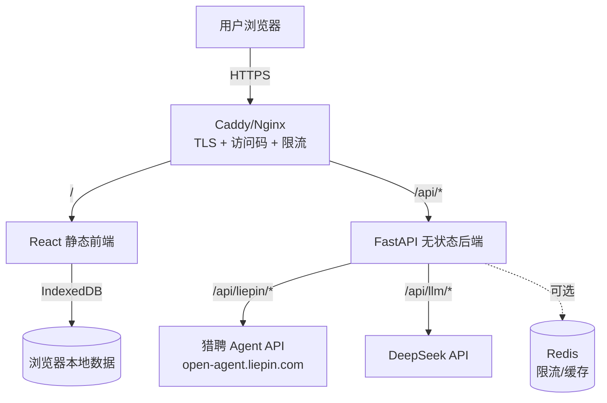

# 可行性验证设计文档（精简版）

**项目：** 自然语言对话式简历生成与精准投放（NLCRA）
**版本：** v1.0（可行性验证提交）
**日期：** 2026-11-03
**范围：** 中国市场 / 单用户工具 / 只接入猎聘 / 可部署到独立主机
**用途：** 赛题可行性验证、技术方案评审、部署演示
**参考：** [02-猎聘Agent接入可行性](02-猎聘Agent接入可行性.md) · [03-猎聘Agent接入技术设计](03-猎聘Agent接入技术设计.md)

---

## 1. 项目概述

### 1.1 一句话

> 一个**无需注册登录**的对话式求职工具：用户粘贴猎聘 token，DeepSeek 通过多轮对话整理经历、生成简历、导入/补充猎聘在线简历、搜索职位、在用户确认后投递，并用“提醒 + 手动状态 + 反馈”完成闭环。

### 1.2 为什么这样定位

| 约束 | 设计选择 |
| --- | --- |
| 第三方 Web 托管用户 token 有合规风险 | 不做账号体系；token 只放浏览器内存/sessionStorage，服务端不落库 |
| 部署到另一台主机 | Web 工具 + Docker 部署；用户打开浏览器即用 |
| 不想让用户手动填 LLM API Key | DeepSeek Key 放服务端 `.env`/Secret，用户无感 |
| 猎聘 API 是 CLI/REST，不是标准 MCP | 后端做同源代理，浏览器不直连猎聘 |
| 猎聘暂不支持状态查询 | 投递后手动状态 + 提醒；等官方 API |

### 1.3 本阶段验证目标

1. 证明“浏览器 → 我们的后端 → 猎聘 API”链路可用（绕过 CORS）；
2. 证明 token 可在不落库的前提下完成简历读取、职位搜索、投递；
3. 证明 DeepSeek 能通过工具调用驱动猎聘操作，且 token 不进入 LLM 上下文；
4. 证明 PDF/DOCX 中文导出可用；
5. 证明 Docker 可一键部署到另一台主机。

---

## 2. 需求映射

| 赛题要求 | 本方案 | 验证方式 |
| --- | --- | --- |
| R1 多轮对话引导 | 五段对话（基本信息/教育/工作/项目/求职意向） | 录屏 10 轮完成 |
| R2 NLP/LLM 抽取填充 | DeepSeek 结构化抽取 + 证据 + 用户确认 | 低置信度确认演示 |
| R3 结构化简历 + PDF/Word | 简历工作台 + PDF/DOCX 导出 | 文件 + ATS 文本回读 |
| R4 求职意向 + 职位匹配 | 猎聘 `search-job` + 匹配报告 | 真实职位 + 报告 |
| R5 投递/建议 + 状态 | 猎聘 `apply-job` + 手动状态 | 真实投递成功 + 时间线 |
| R6 闭环：反向优化/提醒/反馈 | 简历 diff + 提醒 + 反馈调权 | 拒绝反馈 → 权重变化 |

**明确不在本阶段：**

- 用户注册/登录/多租户；
- 实习僧、BOSS、智联、51job、支付宝等其他平台；
- 自动查询猎聘投递状态（官方暂未开放）；
- 服务端保存猎聘密码、浏览器自动化；
- 付费/会员/移动 App。

---

## 3. 总体架构



**关键点：**

- 浏览器只访问同源 `/api`，不直连猎聘，CORS 问题消失；
- 后端**不存用户数据**、**不存猎聘 token**；
- DeepSeek Key 只在后端环境变量/Secret；
- 用户数据（简历、投递、状态）在浏览器 IndexedDB，可导出/导入；
- Redis 可选，仅用于多实例限流/缓存。

---

## 4. 技术选型

### 4.1 前端

| 层 | 选型 | 理由 |
| --- | --- | --- |
| 框架 | React 19 + TypeScript + Vite | 生态成熟、开发快、适合对话/编辑器复杂交互 |
| UI | Ant Design 5 | 表单、表格、时间线、Modal 完整，中文场景友好 |
| 数据请求 | TanStack Query | 缓存、重试、加载/错误状态 |
| 状态 | Zustand | 轻量，适合会话/编辑器状态 |
| 本地数据 | Dexie（IndexedDB） | 简历、投递、事件本地持久化；无需后端 DB |
| 表单/校验 | React Hook Form + Zod | 简历字段/投递确认校验 |
| 流式 | fetch + SSE | DeepSeek 流式输出 |
| PDF 预览 | react-pdf / 浏览器打印 | 预览与导出分离 |
| 测试 | Vitest + Playwright | 单测 + E2E |

### 4.2 后端

| 层 | 选型 | 理由 |
| --- | --- | --- |
| 语言 | Python 3.12 | 团队要求；LLM/文档生态好 |
| 框架 | FastAPI + Pydantic v2 | 类型安全、OpenAPI、SSE 方便 |
| HTTP | httpx | 异步调用猎聘/DeepSeek |
| 模板 | Jinja2 | 简历 HTML 模板 |
| PDF | WeasyPrint + Noto Sans CJK | 轻量、中文嵌入、Docker 体积小；后续可换 Chromium |
| DOCX | python-docx | 原生 Word 生成 |
| LLM | DeepSeek OpenAI 兼容接口 | 服务端 Key；工具调用/JSON 输出 |
| 限流 | slowapi / 自研令牌桶 + Redis 可选 | 防匿名滥用 |
| 部署 | Docker + Caddy | 一键部署、自动 HTTPS |

### 4.3 为什么不用数据库

- 无登录、无多用户，服务端不需要存用户数据；
- 简历/投递/状态存浏览器，降低泄露风险；
- 部署更简单：一个 API 容器 + 一个 Caddy 容器即可；
- 代价：不能跨设备同步、不能做服务端邮件提醒（本阶段接受）。

---

## 5. 核心流程

```text
1. 打开页面 → 输入共享访问码（可选）
2. 引导到猎聘授权页 → 生成 token → 粘贴
3. 后端 GET /mcp/get-resume 验证 → 导入猎聘简历
4. 对话补充缺失信息 → DeepSeek 抽取 → 用户确认
5. 生成/编辑简历 → 导出 PDF/DOCX
6. 填写求职意向 → 猎聘 search-job → 匹配报告
7. 选择职位 → 确认投递 → 猎聘 apply-job
8. 投递后 3/7/14 天提醒 → 用户手动回填状态
9. 反馈结果 → 调整匹配权重 → 下一轮推荐
```

### 5.1 核心页面

| 页面 | 作用 | 关键交互 |
| --- | --- | --- |
| 连接猎聘 | 引导授权 + 粘贴 token | 打开 `/mcp/auth`、验证、脱敏显示、解绑 |
| 对话工作台 | 多轮建档 | 聊天、槽位卡片、抽取确认、跳过/修改 |
| 简历中心 | 我方简历 + 猎聘在线简历 | 预览、编辑、diff、导出 PDF/DOCX、补写到猎聘 |
| 职位推荐 | 猎聘搜索 + 匹配 | 筛选、卡片、匹配报告、收藏/隐藏 |
| 匹配报告 | 要求/证据/缺口 | 分数拆解、逐条证据、定制简历、投递 |
| 投递确认 | 防止误投 | 简历版本、匹配分、平台提示、授权勾选 |
| 投递时间线 | 跟踪与提醒 | 手动状态、备注、提醒、粘贴消息 |
| 设置 | 本地数据/通知 | 导出/导入、清除数据、token 到期提醒 |

---

## 6. 猎聘接入设计

### 6.1 官方接口

| 能力 | 接口 | 说明 |
| --- | --- | --- |
| 读取简历 | `GET /mcp/get-resume` | 导入/对照 |
| 更新基础资料 | `POST /mcp/update-base-info` | 只补缺失 |
| 更新自我评价 | `POST /mcp/update-self-assess` | 只补缺失 |
| 教育/工作/项目 | `/mcp/add-*`、`/mcp/update-*` | 只补缺失 |
| 求职期望 | `/mcp/add-job-want`、`/mcp/update-job-want` | 只补缺失 |
| 搜索职位 | `POST /mcp/search-job` | 关键词/城市/薪资/经验/学历/公司 |
| 投递 | `POST /mcp/apply-job` | `jobId` + `jobKind` 必填 |

Base URL：`https://open-agent.liepin.com`；Header：`x-user-token`。

### 6.2 Token 流程

```text
用户 → 猎聘 /mcp/auth 登录 → 生成 token → 粘贴到我们的页面
→ 前端存 sessionStorage（不进 localStorage）
→ 每次请求经 /api/liepin/* 转发，Header 带 x-user-token
→ 后端不落库、不写日志
```

- 有效期 90 天；无 refresh；到期提示重新生成；
- 频控 60 次/分钟；后端做令牌桶 + 缓存；
- 401/403 → 提示重新授权；
- 用户可在猎聘页面重置 token，旧 token 立即失效。

### 6.3 简历同步

- `get-resume` 拉取猎聘现有简历；
- 只对**缺失字段**生成补充建议；
- diff 预览 → 用户逐项确认 → `add-*`/`update-*`；
- **不覆盖**猎聘已有内容；
- 技能无独立接口，只用于我方匹配/PDF。

### 6.4 职位与匹配

- `search-job` 返回职位；保存 `jobId` + `jobKind`；
- 无 detail 接口：搜索结果是否含 JD 全文需真实 token 验证；
- 有 JD：做“要求 → 证据 → 缺口”；
- 无 JD：用标题/公司/薪资/地点/经验/学历做结构化匹配，并标注“基于有限信息”。

### 6.5 投递与状态

- 确认页展示职位/简历/匹配分/限制提示；
- `apply-job` 成功 → 记 `submitted`；
- **无状态 API**：3/7/14 天提醒用户手动回填已读/面试/拒绝；
- 可选“粘贴猎聘消息 → LLM 抽取状态 → 用户确认”；
- 等官方开放状态 API 后替换为自动同步。

---

## 7. DeepSeek 接入设计

### 7.1 Key 管理

```env
DEEPSEEK_API_KEY=sk-...
DEEPSEEK_BASE_URL=https://api.deepseek.com
DEEPSEEK_MODEL=deepseek-chat
```

- Key 只在后端环境变量/Secret；
- 前端永远拿不到；
- 部署时配置一次，用户无需填写；
- Key 缺失时 `/api/health` 返回 degraded，前端提示“服务未配置”。

### 7.2 调用分层

```text
浏览器 → /api/llm/chat（消息/简历/JD，不含 token）
       ← 模型返回 tool_call
浏览器 → /api/liepin/tool（带 token）→ 猎聘
       → 结果回传 /api/llm/chat
```

- **token 不进入 LLM 上下文**；
- LLM 只看到工具名/参数/结果（可脱敏）；
- 工具白名单：`get_resume`、`search_jobs`、`apply_job`、`update_resume`；
- 所有写操作必须用户确认。

### 7.3 结构化输出

- 抽取：JSON Schema（字段/值/置信度/证据）；
- 匹配：JSON（分数/维度/证据/缺口/建议）；
- 生成：Markdown/结构化 JSON，再由模板渲染；
- 失败重试 1 次；仍失败则降级为“请用户手动补充”。

### 7.4 防滥用

- 匿名限流（IP/指纹）；
- 单次输入/输出 token 上限；
- 每日预算熔断；
- 共享访问码（`APP_ACCESS_CODE`）或 CAPTCHA；
- 私有部署可加 Basic Auth/IP allowlist。

---

## 8. 数据设计（浏览器）

| 存储 | 内容 | 说明 |
| --- | --- | --- |
| `sessionStorage` | 猎聘 token、访问码 | 关标签页即失效；不进 localStorage |
| IndexedDB `profile` | 基本信息、教育、工作、项目、技能、意向 | 本地 |
| IndexedDB `resumes` | 简历版本、模板、导出记录 | 本地 |
| IndexedDB `jobs` | 猎聘职位缓存、匹配报告 | 本地 |
| IndexedDB `applications` | 投递记录、状态、事件 | 本地 |
| IndexedDB `settings` | 模型/通知/隐私设置 | 本地 |

- 提供 JSON 导入/导出；
- 清除浏览器数据 = 删除本地数据；
- 服务端不存简历/投递/token。

---

## 9. 后端接口（精简）

| 接口 | 方法 | 说明 |
| --- | --- | --- |
| `/api/health` | GET | 健康检查（猎聘/DeepSeek 配置状态） |
| `/api/liepin/resume` | GET | 代理 `get-resume` |
| `/api/liepin/resume/sync` | POST | 代理 `add/update-*`（逐项） |
| `/api/liepin/jobs/search` | POST | 代理 `search-job` |
| `/api/liepin/apply` | POST | 代理 `apply-job` |
| `/api/llm/chat` | POST SSE | DeepSeek 对话/工具调用 |
| `/api/resume/export/pdf` | POST | HTML→PDF |
| `/api/resume/export/docx` | POST | 生成 DOCX |

**约定：**

- 猎聘 token 通过 `x-user-token` 请求头传入，后端只透传，不持久化；
- 日志脱敏，不记录 token/简历正文；
- 请求体大小限制 1 MB；
- 超时 30s；DeepSeek SSE 单独超时。

---

## 10. 安全与合规

| 项 | 措施 |
| --- | --- |
| Token | 只存 sessionStorage；后端不落库；日志脱敏；HTTPS |
| XSS | 严格 CSP；不加载第三方脚本；Markdown 白名单渲染 |
| 代理 | 只允许固定猎聘路径；防 SSRF；CORS 白名单 |
| 滥用 | 访问码 + IP 限流 + token 预算 + 每日熔断 |
| DeepSeek | 服务端 Key；不返回前端；数据最小化 |
| 隐私 | 简历本地存储；可导出/删除；告知 DeepSeek 处理 |
| 猎聘条款 | 需确认第三方工具/代理使用；不做未授权自动化 |
| 合规 | PIPL、ICP；如收费/中介，评估人力资源服务许可证 |

---

## 11. 部署设计

### 11.1 拓扑

```text
主机（2C4G，20GB）
├─ Caddy（80/443，TLS，访问码，限流）
│  ├─ / → React 静态文件
│  └─ /api → FastAPI
└─ 可选 Redis（多实例限流/缓存）
```

### 11.2 部署步骤

```bash
git clone <repo>
cp .env.example .env
# 填 DEEPSEEK_API_KEY、APP_ACCESS_CODE、域名
docker compose up -d --build
```

### 11.3 环境变量

```env
DEEPSEEK_API_KEY=sk-...
DEEPSEEK_BASE_URL=https://api.deepseek.com
DEEPSEEK_MODEL=deepseek-chat
LIEPIN_AGENT_BASE_URL=https://open-agent.liepin.com
APP_ACCESS_CODE=...
ALLOWED_ORIGINS=https://your-domain.com
MAX_REQUEST_BYTES=1048576
RATE_LIMIT_PER_MINUTE=30
```

### 11.4 主机要求

- 能出网访问 `open-agent.liepin.com`、`api.deepseek.com`；
- 公网 80/443 + 域名（Caddy 自动 HTTPS）；
- 建议中国大陆/香港，验证猎聘/DeepSeek 网络；
- 如猎聘要求 IP 白名单，配固定 EIP。

---

## 12. 可行性验证计划（核心）

| # | 验证项 | 方法 | 通过标准 |
| --- | --- | --- | --- |
| V1 | 代理/CORS | 浏览器 → `/api/liepin/resume` → 猎聘 | 不出现 CORS 错误，返回简历 |
| V2 | Token | 粘贴有效/无效/过期 token | 有效→已连接；无效→明确错误；不落库 |
| V3 | 简历导入 | `get-resume` → 映射 → 页面展示 | 字段完整度 ≥ 80% |
| V4 | 职位搜索 | 真实关键词/城市 | 返回 ≥ 10 条；保存 `jobId/jobKind` |
| V5 | 真实投递 | 测试职位 `apply-job` | 返回成功；时间线出现 `submitted` |
| V6 | DeepSeek 工具调用 | 对话→tool_call→搜索→回答 | token 不在 LLM 请求中 |
| V7 | PDF/DOCX | 中文简历导出 | 无乱码；pdfminer 可读 |
| V8 | 部署 | 另一台主机 `docker compose up` | 外网可访问；健康检查通过 |

**验证顺序**：V1 → V2 → V3 → V4 → V5 → V6 → V7 → V8。  
**前置条件**：一个可用的猎聘个人 token（仅本地联调，不进仓库/文档）。

---

## 13. 里程碑（10 个工作日）

| 天 | 工作 | 产出 |
| --- | --- | --- |
| D1–D2 | 骨架、Caddy、FastAPI、代理、健康检查 | V1 通过 |
| D3–D4 | token 连接、get-resume、IndexedDB | V2/V3 通过 |
| D5–D6 | DeepSeek 对话、抽取、确认 | 对话可演示 |
| D7–D8 | 猎聘搜索、匹配报告 | V4 通过 |
| D9 | 投递、手动状态、提醒 | V5 通过 |
| D10 | PDF/DOCX、部署、演示 | V7/V8 通过 |

---

## 14. 风险与对策

| 风险 | 影响 | 对策 |
| --- | --- | --- |
| 猎聘不允许第三方代理/token 使用 | 方案需调整 | 先确认条款；备选本地 sidecar |
| CORS/网关限制 | 代理不可用 | 已确认浏览器直连不可行；代理是必需 |
| 无状态 API | 闭环弱 | 手动状态 + 提醒 + 消息粘贴；等官方 |
| 无 JD 详情 | 匹配弱 | fixture 验证；结构化降级；申请 detail |
| 枚举码未知 | 简历同步失败 | 字典表 + 测试 token |
| Token 90 天 | 流失 | 到期提醒 |
| 60/min | 批量受限 | 队列/缓存 |
| DeepSeek 成本/滥用 | 费用失控 | 访问码 + 限流 + 预算 |
| 中文 PDF 排版 | 导出翻车 | Noto CJK + pdfminer 回读 |
| 无 LICENSE | 不能拷 CLI 代码 | 按 API 契约自研 |

---

## 15. 验收标准

- [ ] 另一台主机 Docker 部署成功，外网可访问；
- [ ] 用户无需登录，粘贴猎聘 token 即可用；
- [ ] DeepSeek Key 由服务端配置，用户无感；
- [ ] 可读取猎聘简历并展示；
- [ ] 可搜索猎聘职位并保存 `jobId/jobKind`；
- [ ] 可真实投递一个测试职位；
- [ ] 投递后时间线出现 `submitted`；
- [ ] 可手动更新状态并触发提醒；
- [ ] 可导出中文 PDF/DOCX；
- [ ] token 不出现在日志/URL/localStorage；
- [ ] 无 token 时页面有清晰引导。

---

## 16. 结论

**方案可行，且适合部署到独立主机。** 关键取舍：

1. **不做登录**：降低 token 托管/多租户合规风险，用浏览器本地存储 + 共享访问码；
2. **做同源无状态代理**：解决 CORS，隐藏 DeepSeek Key，token 不落库；
3. **只接猎聘**：单平台做深，避免多平台适配和维护；
4. **接受状态缺口**：猎聘暂无状态 API，用“手动 + 提醒 + 反馈”闭环；
5. **Docker 部署**：一台主机、一个 API、一个 Caddy，环境变量配置 Key，用户无感。

**最大不确定性**：猎聘是否允许第三方工具代理调用用户 token。建议在开发前用个人 token 完成 V1–V5 验证，并同步向猎聘确认条款；若不允许，同一套前端可切换为本地 sidecar 模式，架构不推翻。
